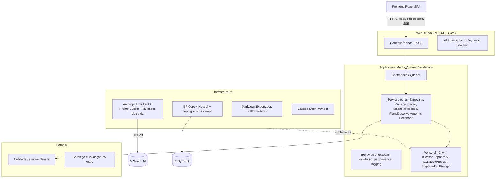
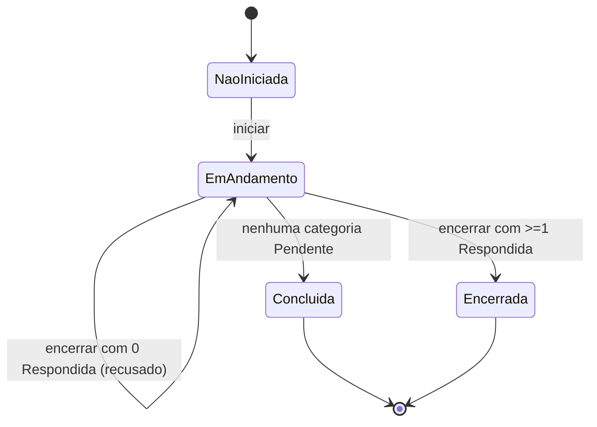
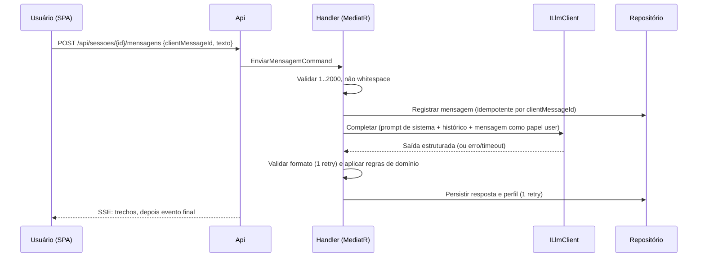

# Design Document: IA Mentor de Carreira

## Overview

O IA Mentor de Carreira é uma aplicação web em que o Usuário conversa com um Assistente_IA em pt-BR, tem o Perfil_do_Usuario construído por uma Entrevista_de_Interesses, recebe de 3 a 5 Recomendacoes_de_Area, consulta o Mapa_de_Habilidades de cada área e exporta um Plano_de_Desenvolvimento.

### Princípio central: LLM para linguagem, código determinístico para regras

O LLM só faz o que exige linguagem natural: conduzir a conversa, extrair informação das respostas e redigir justificativas. Tudo que as regras exigem de forma verificável é calculado por código determinístico: ordenação, limites, conjuntos de áreas válidas, plano de estudo, duração, pré-requisitos e feedback. As saídas do LLM são tratadas como entrada não confiável: passam por um validador de formato e por regras de domínio antes de serem persistidas ou exibidas. Isso também torna a maior parte dos requisitos testável por propriedades.

### Decisões de tecnologia

| Tema | Decisão | Justificativa |
|---|---|---|
| Backend | .NET 8 (C#), Clean Architecture (Domain, Application, Infrastructure, WebUI/Api), MediatR, FluentValidation, EF Core | O projeto é novo e pessoal, então o stack não é imposto por convenção de time. Mantive .NET por três motivos: (1) é a stack em que o autor tem mais domínio, o que reduz o custo de manutenção de um projeto solo; (2) as regras de negócio puras (catálogo, plano, entrevista) ficam em `Domain`/`Application` sem dependência de framework, o que favorece testes de propriedade; (3) o template reaproveita behaviours (validação, logging, exceções) prontos. Alternativas consideradas: Python/FastAPI (ecossistema de LLM mais rico, mas o SDK .NET e HTTP direto cobrem o necessário) e Node/TypeScript (compartilharia tipos com o frontend, mas não traz ganho decisivo). |
| Frontend | React 18 + TypeScript + Vite, SPA responsiva | Streaming de respostas e estado de conversa são simples em React. TypeScript tipa os contratos da API. |
| Banco | PostgreSQL 16 | Relacional com JSONB para o perfil e o plano, suporte maduro no EF Core (Npgsql). |
| Provedor de LLM | Anthropic Claude (modelo da família Sonnet), acessado pela interface `ILlmClient` | O requisito deixou o provedor em aberto. Claude tem boa aderência a saída estruturada via tool use e a instruções em pt-BR. Como o acesso fica atrás de `ILlmClient` na camada `Application`, trocar de provedor (Azure OpenAI, OpenAI) exige só uma nova implementação em `Infrastructure`. |
| Autenticação | Sem contas. Sessão anônima com identificador opaco de 256 bits gerado por CSPRNG, entregue em cookie `HttpOnly; Secure; SameSite=Strict`. | Os requisitos falam em Sessao com "identificador único" e em retomar a Sessao, mas não definem contas, e a exclusão de dados é por Sessao. Contas adicionariam fluxo de cadastro, recuperação de senha e dados pessoais (e-mail), sem requisito que as peça. O identificador não adivinhável funciona como credencial ao portador. Evolução futura: vincular a Sessao a um usuário via OIDC. |
| Tempo real | Resposta do assistente por Server-Sent Events (SSE) | Atende ao primeiro trecho em até 5 s (Req. 10.3) e é mais simples que WebSocket para fluxo unidirecional. |
| Criptografia em repouso | Criptografia de campo com AES-256-GCM via conversores de valor do EF Core; chave em variável de ambiente ou cofre (Azure Key Vault em produção), disco do banco também criptografado pelo provedor | PostgreSQL não tem TDE nativo. A criptografia de campo cobre o Req. 7.6 independentemente do provedor de hospedagem. |
| Exportação | Markdown por renderizador próprio; PDF por QuestPDF | QuestPDF é uma biblioteca .NET pura, sem navegador headless. O Markdown é a fonte; o PDF reutiliza o mesmo modelo de dados. |
| Testes | xUnit + FsCheck (propriedades, backend), Testcontainers (PostgreSQL), Vitest + fast-check (frontend), Playwright + axe-core (responsividade e acessibilidade) | Bibliotecas maduras. Nenhuma implementação própria de PBT. |

### Premissas e lacunas dos requisitos tratadas neste design

- **Horas estimadas e recursos por Habilidade.** O Req. 5.2 usa "horas estimadas das Habilidades" e o Req. 5.1 exige recursos de estudo, mas o Req. 6.2 não os lista no catálogo. O design adiciona `HorasEstimadas` (inteiro de 1 a 500) e de 1 a 3 `Recursos` a cada Habilidade. O plano é, assim, determinístico e não depende do LLM.
- **Etapa com mais de 12 semanas.** O Req. 5.1 limita cada etapa a 1 a 12 semanas, e o 5.2 fixa a duração como `ceil(horas / disponibilidade)`. Se uma única Habilidade exigir mais de 12 semanas na disponibilidade informada, nenhuma etapa válida existe. Nesse caso o gerador retorna o erro `PlanoInviavel`, informando a disponibilidade mínima necessária, em vez de violar os limites. Sugerir ao Usuário revisar a disponibilidade é uma decisão de produto a confirmar.
- **Pontuação de aderência e feedback.** O Req. 9.5 rebaixa áreas "não úteis" sem alterar a pontuação. O design preserva a pontuação original e aplica o rebaixamento só na ordenação de exibição.
- **Persistência de Sessao entre visitas.** A Sessao é retomada pelo cookie. Sem o cookie (outro dispositivo), a Sessao não é recuperável. Isso é consequência da decisão de não ter contas.

## Architecture

### Camadas (Clean Architecture)



Regra de dependência: `Domain` não referencia nada. `Application` depende só de `Domain` e define as portas. `Infrastructure` implementa as portas. `WebUI` faz a composição em `DependencyInjection.cs` de cada camada. O pipeline do MediatR segue a ordem do padrão do projeto: `UnhandledExceptionBehaviour`, `AuthorizationBehaviour` (aqui apenas verifica a posse da Sessao), `ValidationBehaviour`, `PerformanceBehaviour`, `LoggingBehaviour`.

### Máquina de estados da entrevista



Cada uma das seis categorias (`Interesses`, `ExperienciaPrevia`, `Formacao`, `EstiloDeTrabalho`, `DisponibilidadeSemanal`, `Objetivos`) está em um de três estados: `Pendente`, `Respondida`, `NaoRespondida`. A entrevista é concluída quando nenhuma categoria está `Pendente`. Para cada categoria, o contador de reformulações vai de 0 a 1.

### Fluxo de uma mensagem



O mesmo `clientMessageId` em um reenvio devolve a mesma entrada do histórico, o que implementa o Req. 1.5 sem duplicar.

## Components and Interfaces

### Application (portas)

```csharp
public interface ILlmClient
{
    // Saída estruturada validada contra o esquema da tarefa; lança LlmTimeoutException após 30 s sem resposta.
    Task<LlmResultado<T>> CompletarEstruturadoAsync<T>(LlmRequisicao requisicao, CancellationToken ct);
    IAsyncEnumerable<string> CompletarEmFluxoAsync(LlmRequisicao requisicao, CancellationToken ct);
}

public interface ICatalogoProvider
{
    Catalogo Ativo { get; }                                   // último carregado com sucesso
    ResultadoCarga Carregar(string json);                     // valida; em falha mantém o ativo
}

public interface ISessaoRepository
{
    Task<Sessao?> ObterAsync(SessaoId id, CancellationToken ct);
    Task SalvarAsync(Sessao sessao, CancellationToken ct);
    Task ExcluirAsync(SessaoId id, CancellationToken ct);
}

public interface IExportadorPlano
{
    Task<ArquivoExportado> ExportarAsync(PlanoDesenvolvimento plano, FormatoExportacao formato, CancellationToken ct);
}
```

### Application (serviços de domínio puros, sem E/S)

| Serviço | Responsabilidade | Requisitos |
|---|---|---|
| `ValidadorMensagem` | Aceita se `trim` não é vazio e o tamanho está entre 1 e 2000 caracteres | 1.6, 2.8 |
| `MaquinaEntrevista` | Transições de categoria, uma reformulação por categoria, conclusão e encerramento antecipado | 2.2, 2.4 a 2.7 |
| `ValidadorRecomendacoes` | Normaliza e valida a saída do LLM: 3 a 5 itens, sem repetição, só áreas do catálogo, pontuação inteira 0 a 100, justificativa de 1 a 500 caracteres citando item do perfil, ordenação decrescente | 3.1 a 3.4 |
| `ConfiancaRecomendacao` | `BaixaConfianca = categoriasRespondidas < 3` | 3.6 |
| `MapaHabilidadesService` | Todas as Habilidades da área, prioridade do catálogo, ordenação estável por prioridade, marcação de dominadas | 4.1 a 4.4 |
| `PlanoDesenvolvimentoService` | Remove dominadas, ordena topologicamente, agrupa em etapas, calcula durações | 5.1 a 5.4, 5.6, 5.7 |
| `FeedbackService` | Um feedback ativo por área, substituição, reordenação de exibição | 9.1, 9.3 a 9.6 |
| `ValidadorCatalogo` | Limites, unicidade, pré-requisitos existentes, sem auto-referência, sem ciclos | 6.1 a 6.4 |
| `CatalogoSerializer` | JSON UTF-8 do catálogo e carregamento com erros localizados | 6.5 a 6.8 |
| `PromptBuilder` | Monta a requisição ao LLM com o texto do Usuário sempre no papel `user`, delimitado, nunca no prompt de sistema | 8.4 |
| `RepetidorFormatoLlm` | Chama o LLM, valida o formato, repete uma vez, descarta as duas respostas se ambas forem inválidas | 8.5 |
| `RedatorDeSegredos` | Remove valores de segredos configurados de logs e de respostas | 8.6 |

### Contratos da API (WebUI)

Controllers herdam de `ApiControllerBase`, ficam finos e delegam ao `Mediator`.

| Método e rota | Command / Query | Observação |
|---|---|---|
| `POST /api/sessoes` | `SessaoCriarCommand` | Cria a Sessao, define o cookie |
| `GET /api/sessoes/atual` | `SessaoObterQuery` | Restaura histórico, perfil, recomendações, planos |
| `POST /api/sessoes/atual/mensagens` | `MensagemEnviarCommand` | Resposta em SSE; `clientMessageId` para idempotência |
| `POST /api/sessoes/atual/entrevista/encerrar` | `EntrevistaEncerrarCommand` | Recusa se nenhuma categoria foi respondida |
| `GET /api/sessoes/atual/recomendacoes` | `RecomendacaoListarQuery` | Ordem de exibição já aplicando feedback |
| `PUT /api/sessoes/atual/recomendacoes/{areaId}/feedback` | `FeedbackRegistrarCommand` | Substitui o feedback anterior |
| `GET /api/areas/{areaId}/habilidades` | `MapaHabilidadesObterQuery` | Marca dominadas do perfil |
| `POST /api/sessoes/atual/planos` | `PlanoGerarCommand` | Corpo: `areaId` |
| `GET /api/sessoes/atual/planos/{id}/exportar?formato=pdf\|md` | `PlanoExportarQuery` | |
| `DELETE /api/sessoes/atual` | `SessaoExcluirCommand` | Exige confirmação explícita no corpo |

Mensagens de erro ao Usuário usam `IStringLocalizer<MentorLocalization>` (pt-BR como cultura padrão). Os erros de validação seguem `ProblemDetails` com a lista de falhas do `ValidationBehaviour`.

### Frontend (SPA)

Telas: Boas-vindas, Conversa, Recomendações, Mapa de Habilidades, Plano. Componentes principais: `ChatPanel` (lista de mensagens, campo de entrada com contador, indicador de processamento, botão de reenvio), `ProgressoEntrevista` (seis categorias), `RecomendacaoCard` (pontuação, justificativa, controles "útil/não útil", campo de motivo), `HabilidadeLista`, `PlanoEtapas`, `AvisoIA` (aviso fixo visível nas telas de recomendação, mapa e plano; ausente no fluxo de erro do Req. 8.5). Um hook `useMensagemEnvio` mantém o texto digitado em caso de rejeição ou falha e dispara o erro de demora aos 30 s sem primeiro trecho.

### Estratégia de prompts e segurança da IA

- O prompt de sistema define o papel (mentor de carreira em tecnologia), o escopo, o idioma (pt-BR) e a regra de recusa fora de escopo com retomada do tema (Req. 8.1 e 8.2).
- A mensagem do Usuário vai sempre como mensagem `user`, dentro de delimitadores, e nunca é concatenada ao prompt de sistema. Texto que tenta mudar o papel é tratado como conteúdo (Req. 8.4).
- Saídas de extração e recomendação usam tool use com esquema JSON. A resposta de uma mensagem de entrevista traz os campos `proximaPergunta` (exatamente uma) e `extracoes` por categoria.
- O catálogo, com os identificadores de área, vai no contexto da recomendação. A resposta só é aceita se os identificadores existirem no catálogo (Req. 3.3).
- A chave do LLM vem de variável de ambiente ou cofre, não é registrada em log e não aparece em respostas (Req. 8.6).

## Data Models

### Domínio

```csharp
public enum CategoriaEntrevista { Interesses, ExperienciaPrevia, Formacao, EstiloDeTrabalho, DisponibilidadeSemanal, Objetivos }
public enum EstadoCategoria { Pendente, Respondida, NaoRespondida }
public enum PrioridadeHabilidade { Essencial = 0, Importante = 1, Desejavel = 2 }
public enum EstadoEntrevista { NaoIniciada, EmAndamento, Concluida, Encerrada }
public enum TipoFeedback { Util, NaoUtil }

public sealed record Sessao(SessaoId Id, DateTimeOffset CriadaEm, IReadOnlyList<MensagemSessao> Historico,
    PerfilUsuario Perfil, Entrevista Entrevista, IReadOnlyList<RecomendacaoArea> Recomendacoes,
    IReadOnlyList<PlanoDesenvolvimento> Planos, IReadOnlyList<FeedbackRecomendacao> Feedbacks);

public sealed record MensagemSessao(Guid ClientMessageId, int Ordem, PapelMensagem Papel, string Texto, DateTimeOffset CriadaEm);

public sealed record PerfilUsuario(
    IReadOnlyList<string> Interesses, string? ExperienciaPrevia, string? Formacao, string? EstiloDeTrabalho,
    int? HorasEstudoPorSemana,                      // 1..168
    string? Objetivos, IReadOnlySet<HabilidadeId> HabilidadesDominadas);

public sealed record Entrevista(EstadoEntrevista Estado, IReadOnlyDictionary<CategoriaEntrevista, EstadoCategoria> Categorias,
    IReadOnlyDictionary<CategoriaEntrevista, int> Reformulacoes);

public sealed record RecomendacaoArea(AreaId Area, int Pontuacao /*0..100*/, string Justificativa /*1..500*/);
public sealed record FeedbackRecomendacao(AreaId Area, TipoFeedback Tipo, string? Motivo /*0..500*/, DateTimeOffset Em);
```

`SessaoId` é um valor de 256 bits em Base64Url. Quando a Sessao é excluída, o repositório não devolve nenhum dado.

### Catálogo

```csharp
public sealed record Catalogo(IReadOnlyList<AreaAtuacao> Areas, IReadOnlyList<Habilidade> Habilidades);

public sealed record AreaAtuacao(AreaId Id, string Nome /*1..100, único*/, string Descricao /*1..1000*/,
    IReadOnlyList<HabilidadeNaArea> Habilidades /*1..100, ordem preservada*/);
public sealed record HabilidadeNaArea(HabilidadeId Habilidade, PrioridadeHabilidade Prioridade);

public sealed record Habilidade(HabilidadeId Id, string Nome /*1..100*/, string Descricao /*1..300, 1 a 3 frases*/,
    int HorasEstimadas /*1..500*/, IReadOnlyList<RecursoEstudo> Recursos /*1..3*/,
    IReadOnlyList<HabilidadeId> PreRequisitos /*0..10, sem repetição, sem a própria*/);
public sealed record RecursoEstudo(string Titulo, Uri Url);
```

JSON do catálogo (UTF-8; as listas de pré-requisitos são conjuntos, então a ordem entre elementos não afeta a equivalência):

```json
{
  "areas": [{ "id": "backend", "nome": "Desenvolvimento Backend", "descricao": "...",
              "habilidades": [{ "id": "sql", "prioridade": "essencial" }] }],
  "habilidades": [{ "id": "sql", "nome": "SQL", "descricao": "...", "horasEstimadas": 40,
                    "recursos": [{ "titulo": "...", "url": "https://..." }], "preRequisitos": [] }]
}
```

### Plano de desenvolvimento

```csharp
public sealed record PlanoDesenvolvimento(Guid Id, AreaId Area, int HorasPorSemana, IReadOnlyList<EtapaPlano> Etapas, int DuracaoTotalSemanas);
public sealed record EtapaPlano(int Numero /*1..n*/, IReadOnlyList<HabilidadeId> Habilidades /*1..5, em ordem topológica*/,
    int DuracaoSemanas /*1..12*/, IReadOnlyList<RecursoEstudo> Recursos /*1..3*/);
```

Algoritmo de geração (determinístico):

1. Selecionar as Habilidades da área, menos as dominadas. Se o resultado for vazio, retornar `SemHabilidadesPendentes` (Req. 5.7).
2. Ordenar topologicamente respeitando só pré-requisitos não dominados. Empates seguem prioridade e depois a ordem do catálogo.
3. Percorrer a ordem acumulando Habilidades na etapa corrente. Abrir nova etapa quando a corrente já tem 5 Habilidades ou quando somar mais uma tornaria `ceil(horas / disponibilidade)` maior que 12. Como a ordem é topológica, todo pré-requisito fica em etapa anterior ou na mesma etapa, antes da dependente.
4. Se uma Habilidade sozinha excede 12 semanas, retornar `PlanoInviavel`.
5. `DuracaoSemanas` da etapa = `ceil(somaHoras / disponibilidade)`; `DuracaoTotalSemanas` = soma das etapas.
6. Os recursos da etapa são os primeiros 1 a 3 recursos distintos das suas Habilidades, em ordem.

### Persistência (PostgreSQL)

| Tabela | Colunas principais |
|---|---|
| `sessoes` | `id` (PK, hash SHA-256 do identificador; o valor bruto só existe no cookie), `criada_em`, `entrevista` (JSONB), `perfil` (JSONB criptografado) |
| `mensagens` | `sessao_id`, `ordem`, `client_message_id` (único por sessão), `papel`, `texto` (criptografado), `criada_em` |
| `recomendacoes` | `sessao_id`, `area_id`, `pontuacao`, `justificativa` (criptografada), `ordem_original` |
| `feedbacks` | `sessao_id`, `area_id` (PK composta), `tipo`, `motivo` (criptografado), `em` |
| `planos` | `id`, `sessao_id`, `area_id`, `conteudo` (JSONB criptografado) |

Guardar apenas o hash do identificador evita que um vazamento do banco entregue credenciais de Sessao. Todas as consultas filtram pela Sessao do cookie. O catálogo vive em arquivo JSON versionado no repositório, carregado na inicialização; o `ICatalogoProvider` mantém o último catálogo válido na memória.

## Correctness Properties

*A property is a characteristic or behavior that should hold true across all valid executions of a system-essentially, a formal statement about what the system should do. Properties serve as the bridge between human-readable specifications and machine-verifiable correctness guarantees.*

As propriedades abaixo cobrem a lógica determinística. O comportamento do próprio LLM (idioma, uma pergunta por mensagem, recusa fora de escopo, resistência a injeção) e os requisitos de tempo, responsividade e acessibilidade ficam para testes de integração e de exemplo, descritos na estratégia de testes.

### Property 1: Validação do tamanho e do conteúdo da mensagem

*For any* string, o `ValidadorMensagem` aceita a string se e somente se o seu `trim` não é vazio e o seu tamanho está entre 1 e 2000 caracteres. Em caso de rejeição, o estado da Sessao não muda.

**Validates: Requirements 1.6, 2.8**

### Property 2: Criação de Sessao

*For any* conjunto de N criações de Sessao, os identificadores são todos distintos, e cada Sessao nasce com histórico vazio, data e hora de criação preenchida e entrevista em `NaoIniciada` ou `EmAndamento` conforme a ação.

**Validates: Requirements 1.2**

### Property 3: Reenvio de mensagem é idempotente

*For any* mensagem válida e *for any* número k ≥ 1 de reenvios com o mesmo `clientMessageId`, o histórico da Sessao contém exatamente uma entrada da mensagem do Usuário, com o texto original.

**Validates: Requirements 1.5**

### Property 4: Conclusão e encerramento da entrevista

*For any* atribuição de estados às seis categorias, a entrevista está concluída se e somente se nenhuma categoria está `Pendente`. *For any* pedido de encerramento antecipado, o pedido é aceito se e somente se pelo menos uma categoria está `Respondida`; quando aceito, a lista de categorias sem resposta é exatamente o conjunto das categorias não `Respondida`; quando recusado, a entrevista continua `EmAndamento` e nenhuma recomendação é gerada.

**Validates: Requirements 2.4, 2.5, 2.7**

### Property 5: Reformulação ocorre no máximo uma vez por categoria

*For any* sequência de respostas inutilizáveis a uma categoria, a máquina de entrevista reformula a pergunta exatamente uma vez após a primeira resposta inutilizável, e após a segunda resposta inutilizável marca a categoria como `NaoRespondida` e avança. O contador de reformulações de cada categoria nunca passa de 1.

**Validates: Requirements 2.6**

### Property 6: Extração utilizável atualiza o perfil

*For any* categoria e *for any* extração utilizável para ela, depois de aplicada a categoria fica `Respondida`, o Perfil_do_Usuario contém a informação extraída e as demais categorias não mudam.

**Validates: Requirements 2.2**

### Property 7: Recomendações válidas

*For any* saída candidata do LLM e *for any* catálogo, a lista que o `ValidadorRecomendacoes` aceita e devolve tem de 3 a 5 itens, sem Area_de_Atuacao repetida, todas as áreas pertencem ao catálogo, cada pontuação é um inteiro de 0 a 100, cada justificativa tem de 1 a 500 caracteres e cita ao menos um item do perfil, e a lista está em ordem decrescente de pontuação. Candidatas que violam qualquer dessas condições são rejeitadas. A mesma verificação vale para o resultado de um recálculo depois da atualização do perfil.

**Validates: Requirements 3.1, 3.2, 3.3, 3.4**

### Property 8: Aviso de baixa confiança

*For any* Perfil_do_Usuario, o aviso de baixa confiança é exibido se e somente se o número de categorias `Respondida` é menor que 3.

**Validates: Requirements 3.6**

### Property 9: Mapa de Habilidades

*For any* catálogo válido, *for any* área do catálogo e *for any* conjunto de Habilidades dominadas, o Mapa_de_Habilidades contém exatamente as Habilidades da área, cada uma com a prioridade registrada no catálogo; está ordenado por essenciais, depois importantes, depois desejáveis, e mantém a ordem do catálogo entre Habilidades do mesmo nível; e as Habilidades marcadas como dominadas são exatamente a interseção entre o conjunto informado e as Habilidades da área, sem mudar nenhuma posição.

**Validates: Requirements 4.1, 4.2, 4.3, 4.4**

### Property 10: Estrutura do Plano_de_Desenvolvimento

*For any* catálogo válido, área, conjunto de dominadas e disponibilidade de 1 a 168 horas, quando o plano é gerado, as etapas são numeradas 1..n, cada etapa tem de 1 a 5 Habilidades, duração de 1 a 12 semanas e de 1 a 3 recursos. Quando alguma Habilidade sozinha excede 12 semanas, o resultado é `PlanoInviavel`; quando todas estão dominadas, o resultado é `SemHabilidadesPendentes`; nenhum plano vazio é produzido.

**Validates: Requirements 5.1, 5.7**

### Property 11: Duração do plano

*For any* plano gerado, a duração de cada etapa é igual ao teto de (soma das horas estimadas das suas Habilidades ÷ disponibilidade semanal), e a duração total é a soma das durações das etapas.

**Validates: Requirements 5.2**

### Property 12: Dominadas excluídas e pré-requisitos respeitados

*For any* plano gerado, nenhuma Habilidade dominada aparece nele, toda Habilidade pendente da área aparece exatamente uma vez, e *for any* Habilidade H e pré-requisito P de H não dominado, P está em etapa anterior à de H ou na mesma etapa e antes de H.

**Validates: Requirements 5.3, 5.4**

### Property 13: Exportação em Markdown é fiel ao plano

*For any* plano gerado, renderizar em Markdown e interpretar o resultado com o leitor de teste devolve um plano equivalente, com todas as etapas, Habilidades, durações e recursos.

**Validates: Requirements 5.5**

### Property 14: Validação da disponibilidade semanal

*For any* inteiro, o valor é aceito como disponibilidade semanal se e somente se está entre 1 e 168. Enquanto não houver valor aceito, nenhum plano é gerado e o perfil não muda.

**Validates: Requirements 5.6**

### Property 15: Validação do catálogo

*For any* catálogo candidato, o `ValidadorCatalogo` o aceita se e somente se todos estes itens valem: nomes de área únicos com 1 a 100 caracteres, descrições de 1 a 1000, de 1 a 100 Habilidades por área, identificadores de Habilidade únicos, nomes de 1 a 100, descrições de Habilidade de 1 a 300 caracteres e de 1 a 3 frases, de 0 a 10 pré-requisitos sem repetição e sem a própria Habilidade, todos os pré-requisitos existentes e nenhum ciclo de dependência. Em caso de rejeição, o erro identifica a Habilidade afetada e o tipo de falha.

**Validates: Requirements 4.5, 6.1, 6.2, 6.3, 6.4**

### Property 16: Catálogo inválido preserva o catálogo ativo

*For any* catálogo ativo válido e *for any* JSON candidato inválido, a tentativa de carga é recusada e o catálogo ativo continua o mesmo.

**Validates: Requirements 6.4, 6.7**

### Property 17: Round-trip do catálogo

*For any* catálogo válido, serializar produz JSON válido em UTF-8, e carregar o JSON produz um catálogo equivalente, com as mesmas áreas, Habilidades, prioridades e pré-requisitos, independentemente da ordem dos itens nas listas de pré-requisitos. Serializar o catálogo recarregado produz um JSON equivalente ao anterior.

**Validates: Requirements 6.5, 6.6, 6.8**

### Property 18: JSON malformado ou incompleto é recusado

*For any* JSON de catálogo válido, truncá-lo, ou remover um campo obrigatório de uma Area_de_Atuacao ou de uma Habilidade, produz uma recusa do carregamento com um erro que indica o campo ou a posição da falha.

**Validates: Requirements 6.7**

### Property 19: Round-trip de persistência da Sessao

*For any* Sessao válida, salvar e carregar devolve uma Sessao idêntica, incluindo o histórico na mesma ordem cronológica, o perfil, as recomendações, os planos e os feedbacks.

**Validates: Requirements 7.1, 7.2**

### Property 20: Criptografia de campo

*For any* texto, decifrar o resultado de cifrar devolve o texto original, e o texto cifrado de um texto não vazio não contém o texto original. Cifrar duas vezes o mesmo texto gera resultados diferentes (nonce único).

**Validates: Requirements 7.6**

### Property 21: Isolamento da entrada do Usuário no prompt

*For any* mensagem do Usuário, inclusive as que imitam instruções de sistema, o `PromptBuilder` produz um prompt de sistema idêntico ao prompt de sistema fixo, e a mensagem aparece apenas no papel `user`, intacta.

**Validates: Requirements 8.4**

### Property 22: Repetição por formato inválido

*For any* sequência de respostas do LLM, o `RepetidorFormatoLlm` faz no máximo duas chamadas; devolve a primeira resposta válida se uma das duas for válida; se as duas forem inválidas, devolve erro e deixa o histórico e o perfil sem alterações.

**Validates: Requirements 8.5**

### Property 23: Segredos não vazam

*For any* texto de log ou de resposta que contenha o valor de um segredo configurado, a saída do `RedatorDeSegredos` não contém esse valor.

**Validates: Requirements 8.6**

### Property 24: Feedback: um ativo por área, o último vence

*For any* sequência de feedbacks sobre uma Sessao, existe no máximo um feedback ativo por Area_de_Atuacao, e ele é o último registrado para essa área.

**Validates: Requirements 9.1, 9.4**

### Property 25: Ordem de exibição depende só do feedback atual

*For any* lista de recomendações e *for any* sequência de feedbacks, a ordem de exibição tem todas as áreas sem feedback "não útil" antes das áreas com feedback "não útil", nenhuma área é removida, cada grupo mantém a ordenação decrescente por pontuação, as pontuações não mudam, e a ordem é igual à obtida aplicando só o conjunto atual de feedbacks ativos (um feedback "não útil" substituído por "útil" deixa de ter efeito).

**Validates: Requirements 9.4, 9.5**

### Property 26: Validação do motivo do feedback

*For any* string, o motivo é aceito se e somente se tem de 0 a 500 caracteres. O feedback "não útil" é aceito com motivo vazio ou ausente.

**Validates: Requirements 9.3, 9.6**

## Error Handling

Todo erro mostrado ao Usuário é localizado em pt-BR. Os erros nunca expõem detalhes internos, chaves ou o conteúdo bruto do LLM.

| Situação | Detecção | Comportamento | Req. |
|---|---|---|---|
| Mensagem vazia, só espaços ou com mais de 2000 caracteres | `ValidadorMensagem` | Rejeita, mostra o limite de 1 a 2000 e mantém o texto digitado | 1.6, 2.8 |
| LLM sem resposta em 30 s | `CancellationToken` com timeout em `ILlmClient` | Para o indicador, mostra erro, preserva a mensagem no histórico e oferece reenviar; o reenvio usa o mesmo `clientMessageId` | 1.5, 10.5 |
| Saída do LLM fora do formato | `RepetidorFormatoLlm` | Uma nova tentativa; se falhar de novo, descarta as duas, mostra erro com reenvio, preserva histórico e perfil, não exibe a tela de recomendações nem o aviso de IA | 8.5 |
| Saída do LLM com área fora do catálogo ou regra de domínio violada | `ValidadorRecomendacoes` | Tratada como formato inválido (mesma regra do item anterior) | 3.3 |
| Falha de IA ou catálogo com menos de 3 áreas ao recomendar | Handler | Mensagem de erro, perfil inalterado, opção de tentar novamente | 3.7 |
| Pedido de encerrar sem categoria respondida | `MaquinaEntrevista` | Mantém a entrevista ativa e informa que ao menos uma categoria precisa ser respondida | 2.7 |
| Catálogo sem Habilidades para a área, ou indisponível | `MapaHabilidadesService` | Erro, nenhum mapa parcial, opção de tentar novamente | 4.6 |
| Disponibilidade ausente ou fora de 1 a 168 | `PlanoGerarCommandValidator` | Pede a informação, não gera plano, perfil inalterado | 5.6 |
| Todas as Habilidades dominadas | `PlanoDesenvolvimentoService` | Informa que não há pendências; nenhum plano vazio | 5.7 |
| `PlanoInviavel` (Habilidade acima de 12 semanas) | `PlanoDesenvolvimentoService` | Informa a disponibilidade mínima necessária e oferece alterá-la | decisão de design |
| Falha na geração ou exportação do plano | Handler | Erro, opção de tentar novamente, perfil e planos anteriores preservados | 5.8 |
| Catálogo com referência inválida, ciclo ou JSON malformado | `ValidadorCatalogo` / `CatalogoSerializer` | Registra log com a Habilidade ou campo e o tipo de falha, recusa a carga, mantém o último catálogo válido. Se não houver catálogo válido na inicialização, a aplicação sobe em modo degradado: recomendações, mapa e plano respondem com erro de indisponibilidade | 6.4, 6.7 |
| Falha ao persistir mensagem ou resposta | Repositório com uma nova tentativa | Se persistir, mostra "histórico não foi salvo" e mantém a mensagem na interface para reenvio | 7.3 |
| Sessao inexistente, excluída ou cookie inválido | Middleware de sessão | Trata como Sessao vazia ou "Sessao não existe"; nunca vaza dados de outra Sessao | 7.5 |
| Falha ao registrar feedback | Handler | Erro, opção de tentar novamente, recomendações exibidas inalteradas | 9.7 |
| Motivo de feedback acima de 500 caracteres | `FeedbackRegistrarCommandValidator` | Recusa, mostra o limite e mantém o texto | 9.6 |
| Mensagem fora do escopo ou tentativa de alterar instruções | Prompt de sistema | O assistente recusa e retoma o tema de carreira; sessão e histórico seguem normais | 8.2, 8.4 |

Exceções não tratadas são registradas pelo `UnhandledExceptionBehaviour` sem o corpo das mensagens do Usuário e sem segredos, e viram uma resposta `ProblemDetails` genérica (500). Há limite de requisições por Sessao e por IP para proteger o custo do LLM; estourar o limite devolve 429 com mensagem localizada.

## Testing Strategy

### Abordagem dupla

Testes de propriedade cobrem a lógica determinística em muitos dados gerados. Testes de exemplo e de integração cobrem o que não varia com a entrada ou depende de serviços externos.

**Biblioteca de PBT:** FsCheck (com FsCheck.Xunit) no backend e fast-check no frontend. Nenhum framework de PBT é escrito do zero.

**Configuração das propriedades:**
- No mínimo 100 iterações por propriedade (`MaxTest = 100`; 200 para as propriedades de catálogo e plano).
- Cada propriedade é implementada por um único teste de propriedade.
- Cada teste leva um comentário no formato `Feature: ia-mentor-carreira, Property {n}: {título}`.
- Geradores customizados: `CatalogoValido` (DAG de Habilidades com pré-requisitos, limites respeitados), `CatalogoInvalido` (mutações de um válido: referência inexistente, ciclo, duplicata, estouro de limite), `PerfilUsuario`, `SequenciaDeRespostas`, `SequenciaDeFeedbacks` e strings com Unicode, emojis, espaços e tamanhos próximos de 0, 1, 2000 e 2001.

### Mapeamento das propriedades

| Propriedades | Componente testado | Dependências |
|---|---|---|
| 1, 8, 14, 26 | Validadores e regras simples | Nenhuma |
| 4, 5, 6 | `MaquinaEntrevista` | Nenhuma |
| 7, 22 | `ValidadorRecomendacoes`, `RepetidorFormatoLlm` | `ILlmClient` falso |
| 9, 10, 11, 12 | `MapaHabilidadesService`, `PlanoDesenvolvimentoService` | Nenhuma |
| 13 | `MarkdownExportador` + leitor de teste | Nenhuma |
| 15, 16, 17, 18 | `ValidadorCatalogo`, `CatalogoSerializer`, `ICatalogoProvider` | Nenhuma |
| 2, 3, 19 | `SessaoCriarCommand`, `MensagemEnviarCommand`, repositório | PostgreSQL via Testcontainers (ou EF Core em memória para a lógica) |
| 20 | Conversor de criptografia de campo | Nenhuma |
| 21, 23 | `PromptBuilder`, `RedatorDeSegredos` | Nenhuma |
| 24, 25 | `FeedbackService` | Nenhuma |

### Testes de exemplo (unit tests)

- Máquina de entrevista com a sequência completa das seis categorias.
- Timeout de 30 s e reenvio, com `IRelogio` e `ILlmClient` falsos (1.5, 10.5).
- Falha de IA com perfil inalterado (3.7), catálogo ausente (4.6), falha de exportação (5.8), falha de persistência com uma nova tentativa (7.3), falha de registro de feedback (9.7).
- Exclusão: confirmação exigida, dados removidos, consulta posterior devolve Sessao vazia ou inexistente (7.4, 7.5).
- Exportação em PDF gera arquivo válido e contém o texto das etapas (5.5).
- Componentes do frontend (Vitest e Testing Library): indicador de processamento e bloqueio de envio (1.4), aviso de IA visível nas três telas e ausente no fluxo de erro (8.3, 8.5), controles de feedback e campo de motivo (9.1, 9.3), preservação do texto digitado.

### Testes de integração e não funcionais

- **LLM real (poucos exemplos, executados sob demanda ou em pipeline noturno):** resposta em pt-BR (1.3), exatamente uma pergunta por mensagem (2.3), cobertura das seis categorias (2.1), recusa fora do escopo e retomada do tema (8.1, 8.2), resistência a um conjunto fixo de tentativas de injeção de prompt (8.4), detalhes de área em pt-BR (3.5). Esses testes usam asserções por exemplo, porque o comportamento do modelo não é determinístico.
- **Desempenho (k6 ou NBomber, amostra mínima de 100 requisições):** primeiro trecho em até 5 s no p95 (10.3), recomendações em até 10 s no p95 (3.1, 3.4), mapa e recomendação em até 2 s no p95 (4.1, 10.4), restauração da Sessao em até 3 s no p95 (7.2), feedback confirmado em até 2 s no p95 (9.2), carga do catálogo de 20 áreas e 1000 Habilidades em até 5 s (6.3), exportação em até 10 s (5.5).
- **Responsividade e acessibilidade (Playwright + axe-core):** viewports de 360 a 1920 px sem rolagem horizontal nem corte (10.1), 0 violações automáticas de WCAG 2.1 A e AA (10.2), mais verificação manual de teclado e leitor de tela antes de cada release, porque a ferramenta automática não cobre todos os critérios.
- **Segurança e configuração (smoke):** varredura de segredos no repositório e nos logs (8.6), cookie com `HttpOnly`, `Secure` e `SameSite=Strict`, colunas sensíveis cifradas no banco real (7.6), pipeline do MediatR com a ordem prevista.

### Por que alguns requisitos não usam PBT

Tempo de resposta, layout, acessibilidade e comportamento do LLM não têm uma afirmação "para qualquer entrada, P(x) vale" que um gerador consiga checar a baixo custo. Para eles, as medições de desempenho, as ferramentas de acessibilidade e os exemplos com o LLM real são mais informativos que 100 iterações aleatórias.
